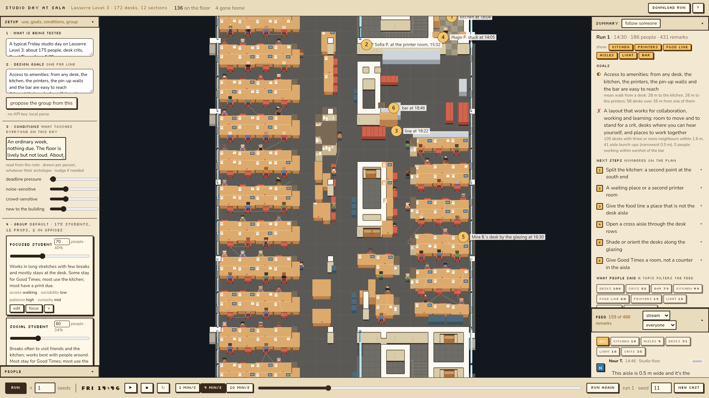

# NPC

NPC is a proof-of-concept tool that uses AI to bring subjectivity into building simulation. Most design-stage simulations, from energy to pedestrian movement, summarize a building through quantitative metrics. NPC instead evaluates a design through the eyes of many different occupants, each with their own preferences.

Users start with a plan, a description of how the space is used, their design goals, and any special cases. The tool generates occupant archetypes from that description and a default set of parameters, then simulates a day in the space. As agents move through it, they comment on what they experience, and those comments are summarized into design suggestions you can trace back to the agent who raised them. New seeds produce new iterations.

The current mockup uses the third-floor studios of the Lasserre Building at UBC. Future versions will accept any input geometry.

**Live demo:** https://fl-79.github.io/npc/ (the hosted demo runs without a Claude API key, so the brief is read by the local parse; run it locally with a key to use Claude)



## Studio day

One Friday afternoon on Lasserre Level 3, the SALA studio floor, simulated in the browser.
Students sit at their desks, act on their own needs (coffee, a late lunch, a print, a stretch, a
chat), get desk crits from the prof of their section, trickle out from 3 pm, and a share of them
line up for food before Good Times opens at 6:30 pm. Each person has a personality. They talk
back about the space, and at the end they review the day.

It is a design tool with the pacing of a game: the plan is the stage, and you play, pause,
stop, loop, scrub, and run again.

## Run it

Requires Node.js 18 or newer. The Claude API is optional: with a key the brief is turned into
the group spec by the model; without one a local parse fills the spec from the brief's numbers
and questions, and everything else works the same.

`tool/scripts/check_furniture.py` lists furniture in the plan that looks wrong or awkward (pieces
over a wall or column, chairs with nothing to sit at, pieces in front of a door) into
`outputs/plan-check/furniture-flags.json`; copied beside the plan as `level3-flags.json`, the
flagged pieces can carry a red mark in the pixel view: the marks are off by default (`stage.opts.flags`
in `stage.js`; set it true to see them). Nothing is moved: the flags are for the plan's owner to
confirm or fix.

`tool/public/plan/level3-edits.json` holds corrections the plan's owner confirmed (pieces removed,
doors removed, walls added, rooms drawn as solid blocks), each with its reason; they are applied
when the plan loads and the DXF export stays untouched.

`tool/scripts/demo-video.mjs` records a one-minute walkthrough as a video (inputs, a run, the
summary, the playback, the feed, the evening) through the installed Chrome; it needs the dev server
running and `npm i -D playwright-core`. The result lands in `outputs/demo/`.

The two interface fonts (Silkscreen for headings, Nunito for text) are SIL Open Font License
files kept in `tool/public/fonts/`, so the page loads nothing from the network besides the
optional API call.

```bash
cd tool
npm install
npm run dev
```

Open http://localhost:5174. To use the API, copy `tool/.env.example` to `tool/.env` and put your
key after `ANTHROPIC_API_KEY=`. The key stays on the dev server; the browser never sees it.

## The flow

1. **Use** (Setup, left): one or two lines on what is being tested. **Design goals**: one per
   line; each is matched to a metric (kitchen, food line, bar, seating, printers, crits, aisles,
   wayfinding, light, doors, desks). "Propose the group from this" asks Claude
   (`claude-opus-5-5`, one structured-output call against a JSON schema, logged in the run
   manifest with model, prompt version and token counts) for the group below; without a key a
   local parse does it.
2. **Studio**: qualities that cut across the patterns, drawn per person so any pattern can carry
   them: deadline pressure (fewer breaks, later nights, more printing, fewer at Good Times), the
   sections under a deadline, and the shares who are noise-sensitive, crowd-sensitive and new
   to the building.
3. **Group**: archetype cards, each with a share bar, its count in small type, the pattern and
   the shares that go to Good Times, use the kitchen and have a print job. Drag a share and the
   other student cards rebalance so the total holds. **Edit** opens the archetype's pattern,
   mobility, shares and trait ranges. **Focus** keeps the plan, the feed and the thoughts box to
   that group. "Add" makes a new archetype from a sentence ("12 noise-sensitive wheelchair
   users"). "Make cast" regenerates the people by seed. The spec file underneath is still the
   truth and goes in the manifest.
4. **Individuals**: a drop-down by name, or click anyone on the plan. "Edit" on the card opens
   trait sliders, pattern and Good Times; "save and pin" keeps that person through any
   regeneration. Edits flow down only: use and goals, then group, then people.
5. **Run** computes the whole afternoon at once, for one seed or up to five (the first is the one
   you can play back). While it computes, the thoughts box shows one sampled remark every three
   seconds and the running count. Then the Summary opens:
   - the goals answered with a glyph and the measured fact, and across several seeds how often
     each verdict held;
   - next steps, one line each, **numbered on the plan at the place they refer to**; the area
     chips show or hide them by topic; click a step or its number on the plan to expand the
     evidence, a jump link into the recording and two quotes;
   - what people said, as topic counts that open the feed.
6. **Playback**: play, pause, stop, loop, speed and scrub on the recorded run; the feed shows the recording up to the playback clock; follow someone;
   the thoughts box shows at most one remark every three seconds at the clock's pace, preferring
   the followed person or the focused group; the Feed tab has everything, as a stream or by
   topic. **Run again** keeps the cast and lets people remember the space (see Learning). **New
   cast** regenerates from the group.

## Good Times

From 17:45 a crew of three (the most sociable Good Times goers) sets up at the counter, which
reports how much clear floor they have. From 18:10 the line forms; the bar opens at 18:30 and
serves one person every 18 to 32 seconds. People then stand at the bar for 6 to 16 minutes and
decide: split off to sit (sofas and benches first, then the classroom chairs, then the desks of
people who went home, within 15 m), with up to two friends following to the same cluster; go
back to a desk to finish a print; or, from 19:00, leave in a rising wave. Someone who wants to
sit and finds nothing says so, and the seating step and goal count it. Where the groups ended
up (classroom, desk rows, stair hall) is reported.

## What is computed and what is inferred

Computed (the body, `src/sim.js`, `src/nav.js`): walkable cells from the plan, routes, walking
distances from every desk to the kitchen, printers and stairs, who is where and when, crit
visits, breaks from needs, kitchen occupancy, printer room occupancy, clearance in front of a
pin-up board, the food line (slots, position, wait), how many people pass a door in five
minutes, aisle clearance where people bunch, desks near the glazing, desk spacing, mood as a
weighted sum of these events, and the rating in each review.

Inferred (the voice, `src/remarks.js`): the sentences. In this build they come from templates
chosen by event and personality and are tagged by topic. The next step replaces the templates
with the Claude API, called at the same events with the same facts, logged in the run manifest
with model and prompt version. The body does not change.

## The cast

One student per desk (175 desks, 12 sections of 11 to 15, three years by thirds of the floor
from north to south) and one prof per section. Each student has six traits (patience,
curiosity, sociability, noise sensitivity, crowding sensitivity, familiarity), a working style
(focused, social, restless), an arrival, a leaving time between 3 and 6 pm, whether they go to
Good Times, whether they have a print job, whether they use the kitchen for coffee, and how
hungry they are at 13:30 (most have not had lunch, so the kitchen is busy in the first hour).

Needs fill at rates set by traits and style. When one crosses its threshold the person acts:
hunger or coffee to the kitchen, a print to the 3D printer room, restlessness to the pin-up
wall, outside, or the computer stations, company to a section-mate's desk. Capacity and
lingering are modelled: the kitchen crowds above seven people, the printer room holds two and
the rest wait in the hall, a pin-up board needs a free metre in front, and from 18:10 the Good
Times goers queue along slots from the bar counter down the central aisle until the bar opens
at 18:30 and serves one person every 18 to 32 seconds.

Profs circulate through their section, choosing among the three nearest unvisited desks so the
order changes from run to run, enter by a different stair each run, wait three minutes at an
empty desk and skip it, do a second round for the desks they missed, and leave. They do not
take kitchen breaks or go to Good Times. Two office profs keep an office routine in the north
and south offices: coffee, a walk past the pin-up boards, one meeting out, home by 17:45.
People who intend to stay for Good Times stay on the floor when their work is done and wind
down (more visits, more kitchen, more pin-up) until the line forms.

## Learning between runs

"Run again" folds the run into the cast's memory before starting the next one: familiarity
rises (fewer wrong turns to the printer room), people who found the kitchen full shift their
lunch, people who waited in the food line join it earlier next time, people who got stuck in an
aisle and are crowd-sensitive route around that spot. Three runs of seed 11 at 35% Good Times:

| run | lost on the way | kitchen crowded | printer full | food line starts | mean line wait |
|---|---|---|---|---|---|
| 1 | 9 | 83 | 24 | 18:10 | 21 min |
| 2 | 0 | 65 | 21 | 17:59 | 30 min |
| 3 | 0 | 67 | 17 | 17:55 | 31 min |

The line forms earlier because people learned to come earlier, and so everyone waits longer.
That is the kind of result the tool exists to show.

## The plan

`public/plan/level3.json` is generated from the Revit plan DXF by `scripts/dxf_to_plan.py`
(Python with ezdxf, shapely, numpy):

```bash
python tool/scripts/dxf_to_plan.py "260630 - Lasserre - Floor Plan - Level 3.dxf" inputs/level3-plan-config.json tool/public/plan/level3.json
```

Walls, floor edge, curtain wall, louvers and door blocks are closed into solids; rooms are the
enclosed free-space regions, named from `inputs/level3-plan-config.json`; furniture is
classified by Revit family name; every desk gets its nearest chair as the seat; desks are grouped
into sections. One partition missing from the export is added from the config. Anything
unconfirmed is listed in the config.

## Known limits of this build

- Remarks are templates. Variety comes from traits, events and the seed, not from a model yet.
- People do not avoid each other; crowding is measured, not resolved.
- The food line has 42 slots; beyond that, people go straight to the bar.
- Mobility on an archetype (wheelchair, stroller, cane) is recorded and shown but does not yet change speed or clearance in the routing.
- Facade orientation is assumed (long sides east and west) for the glazing remarks.
- Mood weights and need rates are first guesses, written as plain numbers in `src/sim.js`.
- The envelope reads heavy because the floor edge and the wall outline are both drawn.
